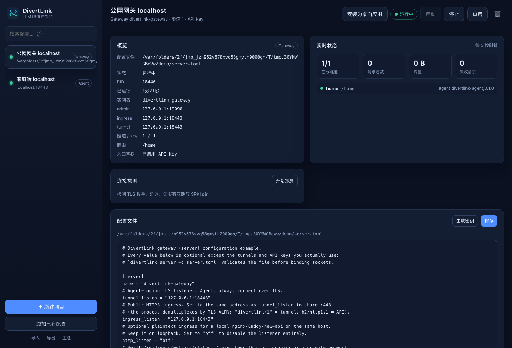

# DivertLink

**中文** · [English](README.en.md) · [文档目录](docs/README.md) · [Releases](https://github.com/Wrste/divertlink/releases)

> **中文**：把运行在家庭宽带上的大模型服务，安全地映射到有固定公网 IP 的服务器上——
> 家庭端主动建立加密反向隧道，公网侧提供 OpenAI / Anthropic / vLLM 完全兼容的 HTTP(S) 入口。
>
> **English**: DivertLink is a secure, high-performance reverse tunnel that exposes
> home-hosted LLM services (OpenAI / Anthropic / vLLM compatible) behind a fixed public IP.

DivertLink 面向“模型跑在家里、入口放在云上”的场景：你在家庭宽带的 GPU 机器上跑
vLLM / Ollama / LM Studio / llama.cpp / new-api，但没有公网 IP、也不想做端口映射。
在云服务器上运行 `divertlink server`，在家庭机器上运行 `divertlink agent`，agent 主动
连向 server 建立一条 TLS 加密长连接；公网用户通过 server 的 443 端口访问模型服务，
协议原样透传、SSE 逐块流式。网关也可以直接作为 new-api / one-api 的上游渠道，
或反向代理到 new-api。

- [特性](#特性)
- [架构](#架构)
- [安装 DivertLink](#安装-divertlink)
- [构建、签名与公证](docs/releasing.md)
- [30 秒快速开始](#30-秒快速开始)
- [图形化客户端](#图形化客户端内置控制台)
- [命令行速查](#命令行速查)
- [接入 new-api / one-api](#接入-new-api--one-api)
- [安全摘要](#安全摘要)
- [性能摘要](#性能摘要)
- [智能体自动部署](#智能体自动部署)
- [文档索引](#文档索引)
- [从源码构建与开发](#从源码构建与开发)
- [项目状态与非目标](#项目状态与非目标)
- [许可证](#许可证)

## 特性

- **协议透明**：网关不解析大模型业务 JSON，只做 HTTP 语义级转发。OpenAI
  `/v1/chat/completions`、Responses API、embeddings、Anthropic `/v1/messages`、
  vLLM `/health` `/tokenize` `/metrics`、rerank 等全部天然兼容。
- **SSE 零缓冲**：流式响应逐块透传、不攒包；客户端断开即取消上游请求。
- **单端口 ALPN 复用**：同一个 443 端口按 TLS ALPN 分流——`divertlink/1` 走 agent
  加密隧道，`h2` / `http/1.1` 走公网 HTTP 入口；防火墙只需放行 443。
- **安全默认**：隧道固定 TLS 1.3 + 隧道 token 认证，可选 mTLS 与证书 SPKI
  pinning；公网入口最低 TLS 版本默认 1.3，可按需降到 1.2 兼容旧客户端；入口 API Key
  认证、限流、体积/并发限制；管理端点只监听 localhost。
- **稳定**：应用层/传输层心跳可组合、指数退避重连（带 jitter）、多会话池与故障转移、
  流式空闲超时、优雅退出；单条 TCP 连接多路复用，不受 NAT/CGNAT 空闲回收影响。
- **简单**：一个静态链接二进制，`divertlink server -c server.toml` /
  `divertlink agent -c agent.toml`；`divertlink init` 一键生成双端配置与证书。
- **高性能**：tokio + hyper、零拷贝 `Bytes`、yamux 多路复用、上游连接池、
  `TCP_NODELAY`、流式双向转发与端到端背压。
- **多模型 / 多对一**：一个网关可同时接入多个模型/多台机器（每条隧道独立 mount、
  并发与鉴权）；一个 agent 可用 `[[targets]]` 路径前缀代理多个本地服务；同一模型可由
  多个 agent 冗余（round-robin + 故障转移）。详见 [多模型部署](docs/multi-model.md)。
- **new-api 友好**：三种组合方式——new-api 把网关配成渠道、网关静态路由反代
  new-api、agent 指向家庭端 new-api。
- **可观测**：`/healthz`、`/readyz`、`/metrics`（Prometheus）、`/status`（隧道快照）。
- **多平台图形客户端**：内置 Web 控制台（`divertlink console`），零依赖、单二进制，
  Windows/macOS/Linux 用浏览器或安装为 PWA 桌面应用；管理多套配置、一键启停、实时日志、
  流量看板、TLS/证书探测与在线编辑配置。参考 [docs/console.md](docs/console.md)。

## 架构

```text
                      公网固定 IP 服务器 (gateway)                         家庭宽带 (agent)
  ┌─────────────────────────────────────────────────────────────┐     ┌─────────────────────┐
  │  :443  TLS (ALPN)                                            │     │                     │
  │   ├─ ALPN "divertlink/1" ── yamux 隧道会话 ◄──────────────────┼─────┼─ 主动 TLS 连接       │
  │   │        │ 控制流(JSON Lines hello/ping/pong)               │     │  yamux client       │
  │   │        └─ 数据流: HTTP/1.1 over yamux (每请求一条流)        │     │   ├─ 控制流          │
  │   └─ ALPN "h2"/"http/1.1" ── 公网 HTTP 入口 (OpenAI/Anthropic)│     │   └─ 数据流 → 本地服务 │
  │                                                              │     │        (vLLM/new-api)│
  │  :8080 (可选) 明文入口（仅回环），前置 nginx/caddy 终止 TLS    │     └─────────────────────┘
  │  :9090 (可选) 管理端点 /healthz /readyz /metrics /status (localhost) │
  └─────────────────────────────────────────────────────────────┘
```

请求路径示例：

| 场景 | 公网 URL | 最终到达 |
| --- | --- | --- |
| 隧道 + mount | `https://gateway.example.com/home/v1/chat/completions` | 家庭端 `/v1/chat/completions` |
| 隧道 + Host 路由 | `https://home.llm.example.com/v1/chat/completions` | 家庭端 `/v1/chat/completions` |
| 静态路由 | `https://gateway.example.com/newapi/v1/chat/completions` | 本机 new-api `/v1/chat/completions` |

## 安装 DivertLink

网关与家庭端都要安装，两端可以使用不同操作系统。同一个可执行文件包含
`server`、`agent` 和浏览器控制台 `console`。

| 平台 | 安装说明 |
| --- | --- |
| Linux x86_64 / ARM64 | [下载、SHA256 校验、解压、用户目录或全局安装](docs/quickstart.md#22-linux-安装发行包) |
| macOS Apple Silicon / Intel | [选择芯片版本、安装、配置 PATH](docs/quickstart.md#23-macos-安装发行包) |
| Windows x64 | [PowerShell 下载、校验、安装、设置用户 PATH](docs/quickstart.md#24-windows-安装发行包) |
| 从源码安装 | [各平台编译依赖、Rust 工具链与安装步骤](docs/quickstart.md#25-从源码安装所有平台) |
| Linux 开机自启 | [systemd 安装脚本、本地二进制安装与服务验证](docs/quickstart.md#26-linux-systemd-安装) |
| Docker | [本地构建镜像与 Compose 部署](docs/deployment.md#5-docker-部署) |

下载入口：[GitHub Releases](https://github.com/Wrste/divertlink/releases)。
[v0.1.0](https://github.com/Wrste/divertlink/releases/tag/v0.1.0) 已提供 Linux x86_64/ARM64
和经过签名、公证的 macOS Intel/Apple Silicon 安装包，下载后即可运行。
Windows 预构建包尚未发布，可先按源码安装步骤构建。
安装后运行 `divertlink version`、`divertlink --help` 验证；桌面用户可运行
`divertlink console --open` 打开图形界面，再继续下方配置步骤。
常见安装问题见[快速开始第 2.7 节](docs/quickstart.md#27-安装验证与常见问题)。

维护者可在 Linux/macOS 上直接构建发布包；macOS 还支持本机 Developer ID 签名、DMG
公证与 stapling。详见[构建、签名与公证](docs/releasing.md)。

## 30 秒快速开始

> 以下 `gateway.example.com`、`home.llm.example.com` 为占位域名，请替换为你自己的域名；
> 令牌必须替换为随机值。完整步骤见 [快速开始](docs/quickstart.md)。

```bash
# ① 网关服务器（有公网 IP）：生成双端配置与自签证书
divertlink init --role both --domain gateway.example.com

# ② 网关：校验并启动（init 已自动写入随机 API Key 与隧道 token）
divertlink check -c server.toml
divertlink server -c server.toml

# ③ 家庭端：把 agent.toml 与 certs/ca.crt 拷到家庭机器，
#    按需修改 [target].url 指向本地模型服务（id/server/token/ca/pin 已由 init 填好），然后启动
divertlink check -c agent.toml
divertlink agent -c agent.toml

# ④ 任意外部机器：经隧道调用家庭端服务（API Key 为 server.toml 中的 [[api_keys]].key）
curl -sS https://gateway.example.com/home/v1/models \
  -H "Authorization: Bearer <网关 API Key>"

curl -N -sS https://gateway.example.com/home/v1/chat/completions \
  -H "Authorization: Bearer <网关 API Key>" \
  -H "Content-Type: application/json" \
  -H "Accept: text/event-stream" \
  -d '{"model":"<家庭端模型名>","stream":true,
       "messages":[{"role":"user","content":"你好"}]}'
```

没有合适域名时，可先用自签证书 + 客户端 `--cacert ca.crt` 验证通路；生产环境建议用
公网 CA 证书并绑定域名。完整的前置条件、防火墙、systemd 托管与验证见
[快速开始](docs/quickstart.md)。

### 不想敲命令？用控制台

```bash
divertlink console --open      # 打开 http://127.0.0.1:17653/
```

在控制台里「＋ 新建项目」→ 填域名/目录 → 一键生成双端配置与证书，然后选中配置点
「启动」即可；实时日志、在线隧道、流量、证书有效期都在一个窗口里。详见
[图形化客户端](docs/console.md)。

### 端到端冒烟验证（可选）

仓库自带 `scripts/smoke.sh`，一条命令即可在临时环境跑通整条链路：自动 `init` 生成双端
配置与自签证书 → 启动 python mock 模型服务 + gateway + agent → 用 curl 验证
`/v1/models`、`/v1/chat/completions`、SSE 逐块到达（带耗时断言）、免认证 `/health`、
未认证请求返回 401，以及管理端点 `/healthz`、`/readyz`、`/status`、`/metrics`。

```bash
./scripts/smoke.sh                               # 自动查找 ./target/release 或 ./target/debug/divertlink
./scripts/smoke.sh -b /usr/local/bin/divertlink  # 或显式指定二进制
DIVERTLINK_BIN=/usr/local/bin/divertlink ./scripts/smoke.sh   # 也支持环境变量
```

依赖 `bash`、`curl`、`python3`（Linux/macOS/WSL/Git Bash）。脚本会自动选择随机空闲端口、
在 `mktemp` 临时目录中运行，退出（含失败）时自动清理进程与临时目录，不会占用或影响本机
已有服务；找不到二进制时先 `cargo build` 或使用 `-b` 指定。

## 图形化客户端（内置控制台）

DivertLink 自带跨平台图形界面：`divertlink console` 启动一个只监听 127.0.0.1 的本地
Web 控制台（编进同一个二进制，无需 Node/Electron/Tauri），浏览器打开即是 UI，也可以
「安装」成 PWA 桌面应用；Windows/macOS/Linux 桌面启动脚本见
`scripts/desktop/`。



它解决了日常最烦的三件事：

- **多套配置**一眼看清状态，一键启动/停止/重启，子进程日志实时滚动；
- **在线隧道 / 请求量 / 流量 / 失败数**卡片，来自网关 `/status` 与 Prometheus 指标；
- **TLS 连接探测**：延迟、协议版本、证书有效期与 SPKI pin，复制即可填进 agent 配置。

```bash
divertlink console --open
```

安全默认：仅回环监听；绑定非回环地址必须 `--token`；写操作要求自定义请求头（防 CSRF）；
不返回任何 CORS 头。远程管理请用 SSH 端口转发。完整说明（含与 cc-switch 等开源项目
的 UI 参考关系、PWA 安装、远程访问、导入导出）见 [docs/console.md](docs/console.md)。

## 命令行速查

```text
divertlink server    [-c server.toml] [--check]
divertlink agent     [-c agent.toml]  [--check] [--once]
divertlink init      [--role server|agent|both] [--dir .] [--domain example.com] [--mtls] [--force]
divertlink gen-certs [--dir certs] [--domain ...] [--self-signed] [--client] [--force]
divertlink token     [--prefix dlk_] [--count 1] [--bytes 24]
divertlink check     -c config.toml [--strict]
divertlink console   [--listen 127.0.0.1:17653] [--open] [--token TOKEN]
divertlink version
```

| 命令 | 用途 |
| --- | --- |
| `server` | 启动网关；`--check` 只校验配置不监听 |
| `agent` | 启动家庭端；`--check` 只校验配置；`--once` 只建立一次连接（排障用） |
| `init` | 生成双端配置与证书并打印 next steps；`--mtls` 额外生成客户端证书；`--force` 覆盖已有文件；`--role agent` 不生成证书 |
| `gen-certs` | 生成 CA / 服务端 / 客户端证书并输出 SPKI pin；`--self-signed` 只生成自签服务端证书；`--client` 供 mTLS 使用 |
| `token` | 生成随机 API Key / 隧道令牌，`--count` 批量生成，`--bytes` 控制随机字节数 |
| `check` | 校验配置文件（按内容自动区分 server 与 agent）；默认打印安全告警，`--strict` 把告警视为错误 |
| `console` | 启动内置图形控制台（本地 Web UI / PWA）；`--open` 自动打开浏览器，`--token` 保护非回环监听 |
| `version` | 打印版本信息 |

常用环境变量：`DIVERTLINK_CONFIG`（`server` / `agent` 的 `-c` 默认值）；agent 侧
`DIVERTLINK_SERVER` / `DIVERTLINK_TOKEN` / `DIVERTLINK_ID`。

管理端点（默认 `127.0.0.1:9090`，只监回环）：

```bash
curl -fsS http://127.0.0.1:9090/healthz   # 存活
curl -fsS http://127.0.0.1:9090/readyz    # 就绪
curl -sS  http://127.0.0.1:9090/status    # 隧道/会话快照
curl -sS  http://127.0.0.1:9090/metrics   # Prometheus 文本指标
```

## 接入 new-api / one-api

三种拓扑均可单独或组合使用，详细字段与操作见
[协议与调用 §5](docs/protocols.md#5-与-new-api--one-api-集成)。

1. **new-api 把网关配成 OpenAI/Anthropic 渠道**（推荐用于额度与渠道管理）
   - OpenAI 类型渠道 Base URL：`https://gateway.example.com/home`（通常不带 `/v1`，
     由渠道拼接 `/v1/chat/completions`；若使用「OpenAI 兼容」类型则填
     `https://gateway.example.com/home/v1`，以渠道测试结果为准）
   - Anthropic 渠道 Base URL：`https://gateway.example.com/home`（不带 `/v1`）
   - 渠道密钥：网关 `[[api_keys]].key`；配合隧道的 `upstream_api_key` 替换模式，
     家庭端真实 Key 不会离开网关。
2. **网关 `[[static_routes]]` 反代到本机 new-api**
   - 例如 `mount = "/newapi"`、`upstream = "http://127.0.0.1:3000"`；
   - 客户端访问 `https://gateway.example.com/newapi/v1/chat/completions`；
   - 静态路由默认 `require_auth = true`，与隧道一样需要网关 API Key；设为 `false`
     则只透传请求头，此时必须由 new-api
     校验客户端令牌（详见协议文档），且 `upstream` 只应指向回环/内网地址。
3. **agent 指向家庭端 new-api**
   - `[target].url = "http://127.0.0.1:3000"`，家庭端 new-api 继续管理本地 vLLM/Ollama；
   - 网关隧道用 `upstream_auth_header = "authorization"` +
     `upstream_api_key = "<new-api 令牌>"` 注入鉴权。

模型名不会被网关改写：客户端/new-api 渠道填写的模型名必须与家庭端服务实际提供的
模型名一致；需要名称映射时用 new-api 的模型重定向。

## 安全摘要

- 隧道：固定 TLS 1.3 + 隧道 token；可选 mTLS（网关 `[tls].client_ca` +
  agent `[tls].client_cert` / `client_key`）与 SPKI pinning。公网入口的
  `[tls].min_version` 可降到 `"1.2"` 兼容旧客户端，agent 隧道始终使用 TLS 1.3。
- 入口：API Key（`Authorization: Bearer` 或 `x-api-key`），按 Key 绑定
  `allow_tunnels` / `allow_ips`，并支持 `rate_limit`、`max_concurrent`。
- 资源保护：请求体上限、请求/流空闲超时、单隧道并发流上限、最大连接数。
- 最小暴露面：家庭端只出站、不开放入站端口；管理端点与明文入口只监听 localhost。
- 可观测：`/metrics` 提供请求量、认证失败、限流、隧道在线等指标；每请求的转发详情
  （Key 名称、隧道、状态码、耗时）在 `debug` 级别日志输出，`[log].format` 可选 `text` / `json`。

> 网关是 TLS 终止点，协议透明不等于端到端加密；家庭端服务应只监听回环地址。
> 威胁模型、密钥轮换、systemd 加固与上线检查清单见 [安全指南](docs/security.md)。

## 性能摘要

- 网关只做认证、限流、路由与字节转发，不解析 JSON、不压缩；处理开销通常在
  亚毫秒到数毫秒量级。
- 一条 TLS/TCP 连接上 yamux 多路复用全部请求，无逐请求握手；上游连接池复用连接；
  `TCP_NODELAY` 降低逐 token 小包延迟；端到端背压避免慢客户端把内存撑爆。
- 主要瓶颈通常是家庭端 GPU 与上行带宽，而不是网关带宽；SSE 纯文本流量很小。
- 容量估算、`oha` / `curl` 压测方法、调参建议见 [性能与容量](docs/performance.md)。

## 智能体自动部署

项目附带 [`divertlink-deploy`](skills/divertlink-deploy/SKILL.md) 技能包，支持智能体检查主机、
安装校验二进制、配置双端 TLS/鉴权、使用 systemd/Docker 部署，并验证指定隧道和 API 入口。
包含 Python 标准库安装与验证脚本，可独立打包为 ZIP；安装方式和中文任务示例见
[技能包使用指南](docs/agent-skill.md)。

## 文档索引

| 文档 | 内容 |
| --- | --- |
| [中英文文档目录](docs/README.md) | 中英文主题导航、安装、配置与运维 |
| [智能体部署技能](docs/agent-skill.md) | 技能安装、自动搭建示例、二进制校验与端到端验证 |
| [快速开始](docs/quickstart.md) | 从零到公网可用：安装、证书、防火墙、启动、验证 streaming、常见错误 |
| [配置参考](docs/configuration.md) | `server.toml` / `agent.toml` 全字段（类型、默认值、必填性、说明），最小配置与完整示例 |
| [协议与调用](docs/protocols.md) | OpenAI / Anthropic / vLLM 的 base_url 拼接、Python SDK 与 curl、认证头、SSE 验证、new-api/one-api 渠道配置 |
| [安全指南](docs/security.md) | 威胁模型、TLS/mTLS/pinning、令牌轮换、限流与可观测、主机加固、上线检查清单 |
| [性能与容量](docs/performance.md) | 性能设计、容量估算、压测方法、调优参数、常见瓶颈 |
| [故障排查](docs/troubleshooting.md) | 按状态码与症状排查（401/403/404/413/429/502/503/504、SSE 缓冲、心跳、TLS、ALPN、NAT） |
| [常见问题](docs/faq.md) | 与 frp/Cloudflare Tunnel 的区别、Ollama、Windows、多模型、域名、mTLS 等 |
| [多模型 / 多对一](docs/multi-model.md) | 三种多对一拓扑、一个 agent 多上游前缀路由、多 agent 同隧道冗余、鉴权配额、base_url 与调优 |
| [图形化客户端](docs/console.md) | 内置控制台：多配置管理、一键启停、实时日志、流量看板、TLS/证书探测、PWA、远程访问与安全模型 |
| [部署文档](docs/deployment.md) | Docker/Compose、systemd、nginx/Caddy、证书获取、升级回滚 |
| [示例配置](examples/README.md) | 可直接运行的双端示例与三端拓扑 |
| [设计说明（内部契约）](docs/DESIGN.md) | 架构与接口契约，面向实现者与贡献者 |

## 从源码构建与开发

建议使用当前 Rust stable；包声明 MSRV 为 1.88，但锁定依赖可能要求更高版本：

```bash
git clone https://github.com/Wrste/divertlink.git
cd divertlink
cargo build --release --locked          # 产物：target/release/divertlink
cargo fmt --check
cargo clippy --all-targets -- -D warnings
cargo test
cargo run -- console --open   # 内置图形控制台（可选）
```

本仓库已内置本地工具链时，可先执行 `. ./scripts/env.sh` 再运行 cargo 命令。
各平台构建依赖与二进制安装方法见[源码安装](docs/quickstart.md#25-从源码安装所有平台)。
项目为单 crate；`src/` 目录划分（config、tls、protocol、registry、httpfwd、server、
agent 等）见 [DESIGN 第 3 节](docs/DESIGN.md#3-仓库结构单-crate)。
CI 会在 Linux/macOS/Windows 上执行测试矩阵（fmt、clippy、doc 检查在 Linux 上运行），
release 工作流在打 tag 时构建 Linux musl（x86_64/aarch64）、macOS（aarch64/x86_64）与
Windows x86_64 产物。

## 项目状态与非目标

当前版本 **0.1.0（MVP）**。以下能力不在 MVP 范围（见
[DESIGN 第 9 节](docs/DESIGN.md#9-非目标mvp-不做)）：动态隧道注册/管理 Web UI、
ACME 自动签发证书、QUIC/WebSocket 传输、跨网关联邦。
同一隧道多 agent 负载均衡与故障转移、本地图形控制台已实现。
WebSocket、gRPC、HTTP/3 请求无法经隧道透传；普通 HTTP/1.1、HTTP/2 与 SSE 不受影响。

欢迎通过 Issue / Pull Request 参与贡献；提交前请确保 `cargo fmt`、`clippy`、
`cargo test` 全部通过。

## 许可证

本项目以 **MIT OR Apache-2.0** 双许可证发布，任选其一使用：

- [LICENSE-MIT](LICENSE-MIT)
- [LICENSE-APACHE](LICENSE-APACHE)
