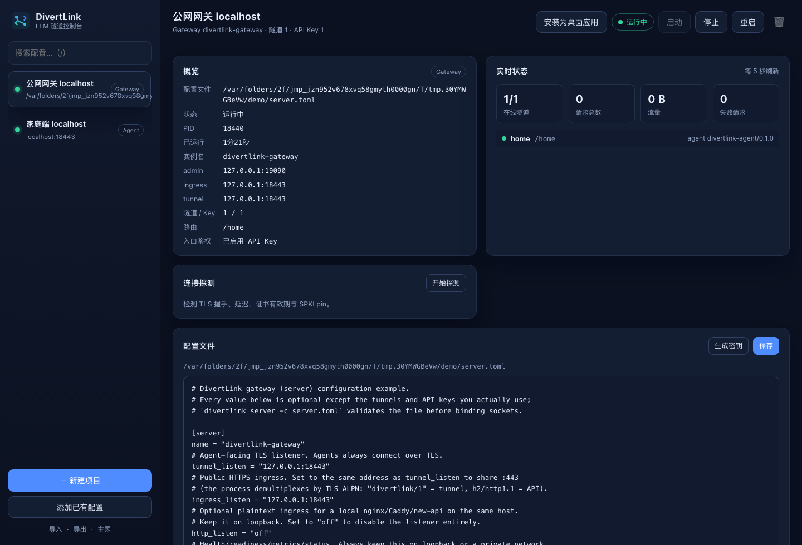

# 图形化客户端：内置控制台（多平台）

DivertLink 自带一个**零依赖、跨平台**的图形化控制台。它编译进同一个 `divertlink`
二进制里，不需要 Node、不需要 Electron/Tauri、不需要额外安装任何运行时；在
Windows / macOS / Linux 上用浏览器打开即可使用，也可以「安装」成桌面应用（PWA）
或在手机/平板上访问（通过 SSH 端口转发或内网）。

```bash
divertlink console            # 启动控制台：http://127.0.0.1:17653
divertlink console --open     # 启动并自动打开浏览器 / PWA 窗口
```



> 上图为控制台实际界面：左侧多套配置与本机进程状态，右侧为当前配置的概览、在线隧道/
> 流量看板、TLS 连接探测与在线配置编辑器。

> 控制台是**本地管理工具**：默认只监听 `127.0.0.1`，不会暴露到公网；公网入口仍然
> 由网关的 443 端口提供。远程管理请用 SSH 端口转发，见 [远程访问](#远程访问)。

## 目录
- [为什么内置控制台](#为什么内置控制台)
- [参考的开源项目](#参考的开源项目)
- [快速开始](#快速开始)
- [界面与功能](#界面与功能)
- [跨平台启动方式](#跨平台启动方式)
- [安装为桌面应用（PWA）](#安装为桌面应用pwa)
- [远程访问](#远程访问)
- [安全模型](#安全模型)
- [命令行参数](#命令行参数)
- [常见问题](#常见问题)

## 为什么内置控制台

DivertLink 的双端都是命令行程序，但真实用户往往同时管着「云上网关」和「家里 GPU
机器」两套配置，还要看隧道是否在线、SSE 是否正常、证书是否快过期。控制台把这些
日常操作变成一个窗口：

- 多套配置（profile）分组管理，一键启动/停止/重启；
- 实时显示子进程日志（stdout/stderr），自动滚动、可暂停；
- 网关在线隧道数、请求量、流量、失败数（Prometheus 指标的可视化）；
- TLS 连接探测：握手延迟、协议版本、证书有效期、SPKI pin（复制即可填入 agent 配置）；
- 配置文件在线编辑（保存前做完整校验，旧版本自动备份为 `.toml.bak`）；
- 新建项目向导：一键生成 `server.toml` / `agent.toml` / 证书，并自动登记为 profile。

## 参考的开源项目

UI/交互参考了以下优秀开源项目（均为独立项目，DivertLink 未复用其代码）：

| 项目 | 说明 | 地址 |
| --- | --- | --- |
| CC Switch | Tauri 桌面应用，多供应商配置一键切换、系统托盘、深色模式、SSOT 配置 | <https://github.com/farion1231/cc-switch> |
| cc-switch-web | 同一项目的 Web runtime 分支：单二进制 Web UI，适配无头/SSH 环境 | <https://github.com/cp-yu/cc-switch-web> |
| pi-switch | cc-switch 风格的 profile 管理器：卡片列表、漂移检测、导入导出 | <https://github.com/goehou/pi-switch> |
| frpc-desktop | FRP 的跨平台桌面客户端：可视化配置 + 一键运行 | <https://github.com/luckjiawei/frpc-desktop> |
| frpmgr | Windows 上的 FRP 图形客户端：把配置注册为系统服务 | <https://github.com/koho/frpmgr> |

DivertLink 控制台与它们的关系：

- 采用「左侧 profile 列表 + 顶部状态胶囊 + 一键启动」的交互模型（cc-switch 风格）；
- 采用「单二进制 Web runtime」的分发方式（cc-switch-web 风格），因此没有安装包、
  没有自动更新器，也不会在用户机器上常驻后台服务；
- 提供 profile 导入/导出 JSON（pi-switch 风格）；
- 与 frpc-desktop / frpmgr 的差异：DivertLink 控制台不注册系统服务（服务化请用
  systemd / NSSM，见 [部署文档](deployment.md)）。

## 快速开始

1. 启动控制台：

   ```bash
   divertlink console --open
   ```

   终端会打印 `DivertLink 控制台已启动：http://127.0.0.1:17653/`。

2. 点击左下角 **「＋ 新建项目」**，填写：
   - 项目目录（如 `~/divertlink-home` 或 `C:\divertlink`）
   - 公网域名或 IP（如 `llm.example.com`）
   - 生成内容：双端 / 仅网关 / 仅家庭端
   - 需要 mTLS 时勾选「生成 mTLS 客户端证书」

   生成完成后会弹出 API Key、Agent Token、SPKI pin，均可一键复制。

3. 在左侧选中新配置，点击顶部 **「启动」**。网关配置会绑定 443（非 root 用户请先
   按部署文档设置 `CAP_NET_BIND_SERVICE` 或改用高位端口）。

4. 「实时状态」卡片查看在线隧道与流量；「连接探测」验证 TLS/证书；
   「实时日志」查看运行输出。

5. 家庭端机器上重复第 1 步，添加 `agent.toml` 配置并启动即可。

> 控制台只管理**由它启动**的子进程。用 systemd/Docker 启动的实例不会出现在进程
> 状态里，但可以用「连接探测」和网关的 `/status` 查看隧道是否在线。

## 界面与功能

| 区域 | 内容 |
| --- | --- |
| 侧边栏 | 品牌、搜索（`/`）、profile 列表（状态点 + 角色标签）、新建/添加/导入/导出/主题 |
| 顶部栏 | 当前配置名、一句话摘要、状态胶囊（未运行/运行中/停止中/异常退出）、启动/停止/重启/删除 |
| 概览 | 配置文件路径、PID、运行时长、监听地址、隧道与 Key 数量、路由 mounts、认证状态；agent 配置的多上游（`[[targets]]`）会逐条列出前缀与地址 |
| 实时状态 | 在线隧道数、请求总数、流量、失败数；逐隧道列出 mount / agent 版本 / 在线状态，多 agent 同隧道时显示 agent 数 |
| 连接探测 | 对 agent 配置探测其网关；对网关配置探测本机 TLS 监听；显示延迟、TLS 版本、加密套件、ALPN、证书 SAN、到期天数、SPKI pin |
| 配置文件 | 只读加载 + 在线编辑；保存前按角色完整校验；旧文件备份为 `.toml.bak` |
| 实时日志 | 子进程 stdout/stderr 合流显示，SSE 推送；自动滚动、暂停、清屏 |

快捷键：`/` 搜索、`n` 新建、`r` 重启当前配置、`p` 探测、`Esc` 关闭弹窗。

## 跨平台启动方式

三种方式任选，均不需要额外运行时：

### 1) 直接命令行（所有平台）

```bash
divertlink console --open
```

### 2) 双击启动脚本（仓库 `scripts/desktop/`）

| 平台 | 文件 | 说明 |
| --- | --- | --- |
| macOS | `scripts/desktop/divertlink-console.command` | 双击运行（首次需在「系统设置 → 隐私与安全性」允许） |
| Windows | `scripts/desktop/divertlink-console.bat` | 双击运行，自动打开默认浏览器 |
| Linux | `scripts/desktop/divertlink-console.desktop` | 复制到 `~/.local/share/applications/` 后出现在应用菜单 |

脚本会依次查找 `PATH` 中的 `divertlink`、`./target/release/divertlink`、
`./target/debug/divertlink`，也可以设置 `DIVERTLINK_BIN` 指定路径。

### 3) PWA（推荐日常使用）

见下一节。安装后是一个独立窗口，有开始菜单/程序坞图标，可离线打开 UI 外壳。

## 安装为桌面应用（PWA）

Chrome / Edge / Safari 支持把本地页面安装成应用：

1. 打开 `http://127.0.0.1:17653/`；
2. 地址栏右侧点击「安装」图标（或菜单 →「安装 DivertLink 控制台」）；
3. 之后从开始菜单 / 启动台打开即可，窗口独立、无浏览器地址栏。

移动端（iOS Safari / Android Chrome）也可「添加到主屏幕」，配合 SSH 端口转发或
内网地址在手机上看状态。

> PWA 只是把 UI 外壳缓存到本地，**API 数据仍来自本机控制台进程**；控制台没启动时
> 页面会提示无法连接后端。

## 远程访问

控制台默认只监听回环地址。需要从笔记本管理远端的网关时，用 SSH 本地端口转发：

```bash
ssh -N -L 17653:127.0.0.1:17653 user@gateway.example.com
# 然后在本机打开 http://127.0.0.1:17653/
```

需要让控制台直接监听内网地址时，**必须**设置访问令牌：

```bash
divertlink console --listen 0.0.0.0:17653 --token "$(divertlink token --prefix cons_ | head -1)"
```

未提供 `--token` 时，控制台会拒绝绑定非回环地址（防止把管理面暴露成开放代理）。
浏览器访问时在控制台「设置令牌」输入一次即可（保存在 localStorage，仅本机）。

## 安全模型

| 风险 | 缓解措施 |
| --- | --- |
| 管理面暴露公网 | 默认 `127.0.0.1`；非回环绑定强制要求 `--token`；建议用 SSH 转发 |
| DNS rebinding / 恶意网页跨站调用 | 校验 `Host` 头；所有写操作要求自定义头 `x-divertlink-console: 1`，浏览器跨域无法在不触发 CORS 预检的情况下发送；服务端从不返回 CORS 允许头 |
| 令牌泄漏 | 令牌仅在请求头/查询参数中出现，不写入日志；`--token` 可用环境变量 `DIVERTLINK_CONSOLE_TOKEN` 传入，避免出现在 shell 历史 |
| 子进程被滥用 | 控制台只启动当前二进制 + 已知子命令 + 已登记的配置文件路径；不接受任意命令 |
| 配置文件误编辑 | 保存前完整校验（server/agent schema + 交叉约束）；旧版本备份 `.toml.bak` |
| profile 存储 | JSON 权限 `0600`，默认位于 `~/.config/divertlink/console/profiles.json`（macOS `~/Library/Application Support/divertlink/`，Windows `%APPDATA%\divertlink`）；可用 `DIVERTLINK_HOME` 覆盖 |

控制台不改变网关/agent 的安全边界：它只是把同样的命令用 UI 串起来。

## 命令行参数

```
divertlink console [OPTIONS]

--listen <ADDR>     监听地址，默认 127.0.0.1:17653；0 表示随机空闲端口（测试用）
--token <TOKEN>     访问令牌（非回环监听时必填；也可用 DIVERTLINK_CONSOLE_TOKEN）
--open              启动后打开默认浏览器
--store <PATH>      profile 存储路径（便携模式/测试）
--no-autostart      不自动启动标记了 autostart 的 profile
```

环境变量：

- `DIVERTLINK_HOME`：用户数据目录（覆盖默认的 profile 存储位置）；
- `DIVERTLINK_CONSOLE_TOKEN`：等同 `--token`；
- 由控制台拉起的子进程会带上 `DIVERTLINK_CONSOLE=1`，便于日志区分。

## 常见问题

**Q：控制台能替代 systemd / Docker 吗？**
不能。控制台是交互式管理工具，进程随控制台退出而停止；长期运行请用 systemd /
Docker（见 [部署文档](deployment.md)），控制台只用于查看和临时操作。

**Q：为什么启动网关后「实时状态」显示未就绪？**
网关 `/readyz` 在有隧道配置且没有 agent 在线时返回 503，这是预期行为；「概览」里
的进程状态应为「运行中」。启动 agent 后即可变为就绪。

**Q：日志里为什么只有 `console` 前缀的行？**
`console` 行是控制台自身的操作（启动/停止/保存配置）；子进程的 stdout/stderr 会
以 `stdout`/`stderr` 前缀出现在后面。若子进程立即失败，`console` 行会记录退出码。

**Q：端口 17653 被占用？**
`--listen 127.0.0.1:0` 使用随机端口（启动日志会打印实际地址），或换一个端口。

**Q：能管理多台机器吗？**
控制台管理本机进程；多台机器请各自运行控制台，或通过 SSH 转发访问远端控制台。
profile 可以用「导出/导入」在机器之间迁移（不包含证书文件本身）。

**Q：有没有原生托盘应用（像 cc-switch 那样）？**
当前版本用「本地 Web UI + PWA」实现跨平台，避免引入 Electron/Tauri 依赖与签名
分发成本；如果你需要原生壳，可以按 [DESIGN.md](DESIGN.md) 的扩展点用 Tauri 包一层
同样的 HTTP API（无 IPC 逻辑）。
