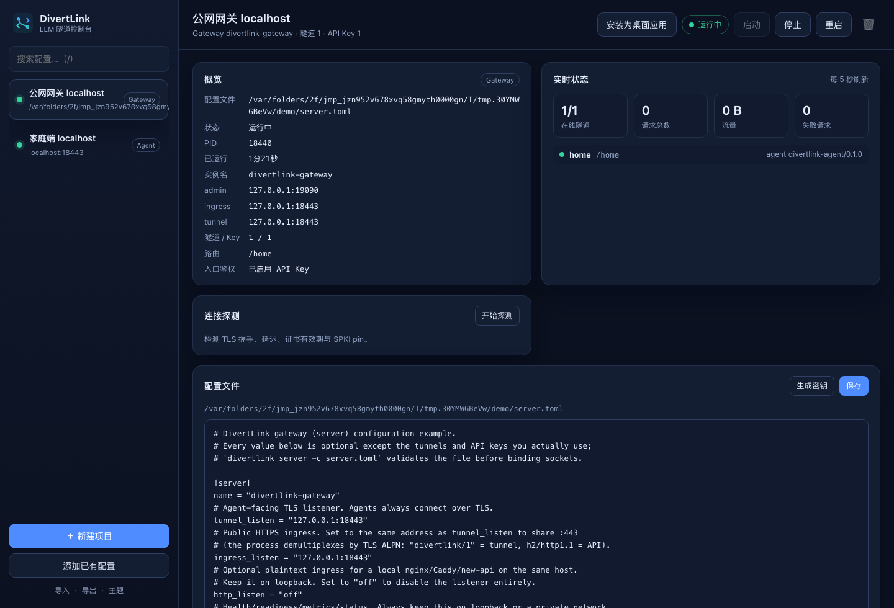

# Local console and PWA

[中文](../console.md) · [English index](README.md)

```bash
divertlink console --open
```

The same binary serves a local browser interface at `http://127.0.0.1:17653/`; Node.js/Electron is unnecessary. Chrome/Edge can install it as a PWA through their browser menu. Portable desktop launchers are in [scripts/desktop](../../scripts/desktop/README.md).



Create a new project to generate configuration and certificates, or import an existing local profile. Select the profile to start/stop/restart its gateway or agent, view process logs, inspect gateway status/traffic and probe TLS certificates. Save a backup before editing live configuration. Generated credentials and exported profiles must be treated as private data.

The console UI currently uses Chinese labels; this English guide explains its operation and does not imply UI localization. “＋ 新建项目” creates a project, “启动” starts the selected process, “停止” stops it. Creating a project or saving a configuration alone does not prove the route works: complete [end-to-end verification](quickstart.md#verify-the-route).

The console supervises **local** child processes, not arbitrary remote servers. Exiting it stops managed children. For unattended/reboot operation use a [service manager](deployment.md). Avoid running the whole console as root just to bind 443; use a nonprivileged port or a Linux server unit.

For remote administration keep it loopback-bound and use SSH:

```bash
# Run console on gateway without --open; then from your workstation:
ssh -L 17653:127.0.0.1:17653 gateway-host
```

Open `http://127.0.0.1:17653/` on the workstation. A non-loopback console binding requires `--token`; prefer forwarding rather than exposing it publicly. Mutation endpoints require a custom request header and no CORS headers are emitted, but those controls do not make public exposure appropriate by default.

`--listen` changes the address, `--store` selects the local profile store and `--no-autostart` disables configured profile startup. Use `divertlink console --help` for the installed version. Further UI behavior, import/export details and references are documented in the [expanded Chinese guide](../console.md).
